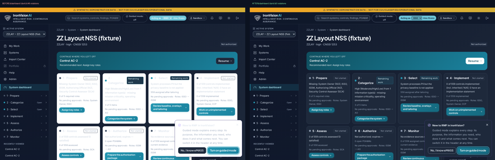
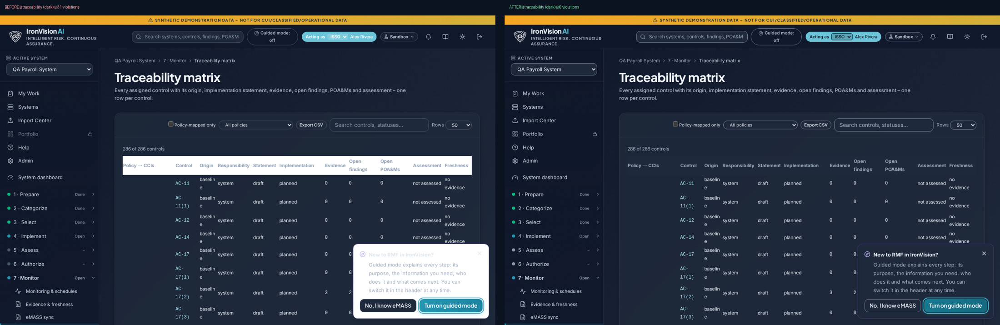
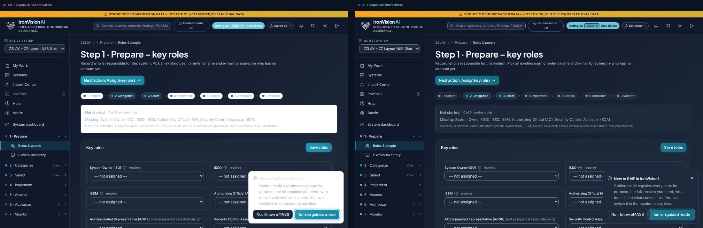
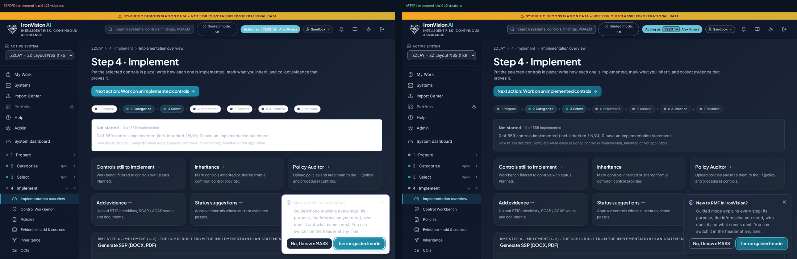
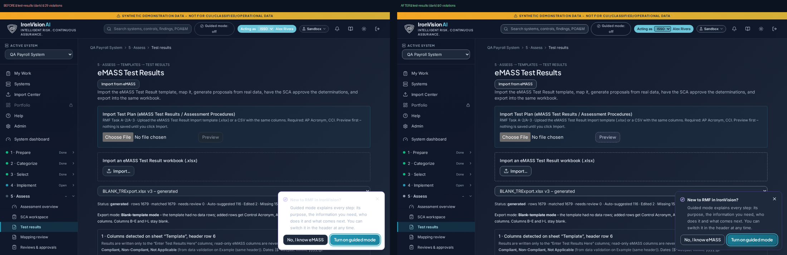
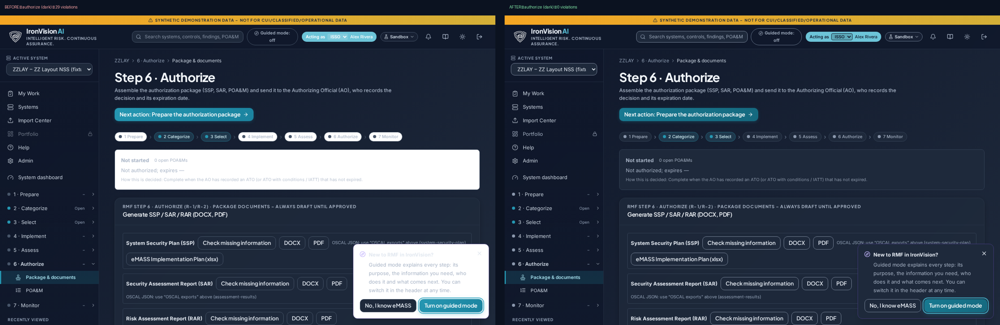

# Night-mode contrast – before / after

WCAG 2.2 AA: text 4.5:1 (3:1 large), non-text UI, borders and focus indicators 3:1, disabled labels 3:1.
Checked by `scripts/check_contrast.py` (axe-core `color-contrast` + computed contrast of resting, hover and keyboard-focus states of a sample of buttons, button links, tabs, switches, inputs and status dots) on every route of the layout checker, dark and light, 1280 and 390 wide.

## Root cause

- Dark theme inverts palette shades 400–950 into light colours; white or dark-slate text on those solid fills (role pill, toasts, badges) dropped to 1.1–2:1.
- `bg-white` is not a theme variable – white panels stayed white in dark mode under light text.
- Control borders (`--iv-border-strong`) were 1.4:1 (light) and 1.9–2.4:1 (dark); the primary fill (#2597B2) gave white text 3.4:1, destructive 3.8:1.
- Disabled and dimmed items used 45–60 % opacity (labels ≈2:1); `outline-none` utilities removed focus rings; status dots 1.5–2.5:1.

## Fix (tokens / variants – applies everywhere)

`--iv-control-border`, `--iv-outline-border`, `--iv-placeholder`, `--iv-disabled-*`, darker `--iv-grad-brand` and `--iv-grad-danger`; one dark-ink rule for light fills in dark mode; dark `bg-white`; light-mode 700 shade under white text on mid fills; `.iv-dimmed` instead of opacity; dashed disabled buttons with readable labels (reason tooltips unchanged); `:focus-visible` ring cannot be removed; status-dot shades 3:1.

## Violations by route (axe + computed)

| Route | dark-1280 before → after | dark-390 before → after | light-1280 before → after | light-390 before → after |
|---|---|---|---|---|
| admin | 20 → **0** | 17 → **0** | 13 → **0** | 12 → **0** |
| assess | 26 → **0** | 25 → **0** | 13 → **0** | 14 → **0** |
| audit-log | 19 → **0** | 17 → **0** | 13 → **0** | 13 → **0** |
| authorization-package | 20 → **0** | 16 → **0** | 13 → **0** | 11 → **0** |
| authorize | 29 → **0** | 28 → **0** | 13 → **0** | 14 → **0** |
| catalog | 20 → **0** | 16 → **0** | 13 → **0** | 11 → **0** |
| catalog-tree | 20 → **0** | 18 → **0** | 13 → **0** | 13 → **0** |
| catalog-tree-system | 19 → **0** | 15 → **0** | 13 → **0** | 11 → **0** |
| categorize | 26 → **0** | 24 → **0** | 14 → **0** | 15 → **0** |
| categorize-fips | 23 → **0** | 19 → **0** | 14 → **0** | 14 → **0** |
| ccis | 20 → **0** | 18 → **0** | 13 → **0** | 13 → **0** |
| control-detail | 20 → **0** | 17 → **0** | 13 → **0** | 14 → **0** |
| control-detail-fips | 20 → **0** | 16 → **0** | 13 → **0** | 14 → **0** |
| dashboard | 46 → **0** | 43 → **0** | 13 → **0** | 11 → **0** |
| docs | 20 → **0** | 16 → **0** | 14 → **0** | 12 → **0** |
| emass | 20 → **0** | 16 → **0** | 13 → **0** | 11 → **0** |
| evidence-ledger | 20 → **0** | 16 → **0** | 15 → **0** | 11 → **0** |
| evidence-sources | 20 → **0** | 17 → **0** | 13 → **0** | 14 → **0** |
| help | 20 → **0** | 18 → **0** | 13 → **0** | 13 → **0** |
| implement | 29 → **0** | 28 → **0** | 13 → **0** | 14 → **0** |
| import-center | 20 → **0** | 18 → **0** | 13 → **0** | 13 → **0** |
| inheritance | 20 → **0** | 16 → **0** | 13 → **0** | 11 → **0** |
| inventory | 24 → **0** | 21 → **0** | 14 → **0** | 15 → **0** |
| mapping-review | 13 → **0** | 9 → **0** | 5 → **0** | 4 → **0** |
| monitor | 24 → **0** | 22 → **0** | 13 → **0** | 14 → **0** |
| my-work | 23 → **0** | 19 → **0** | 13 → **0** | 11 → **0** |
| notifications | 20 → **0** | 16 → **0** | 13 → **0** | 11 → **0** |
| parameter-comparison | 25 → **0** | 24 → **0** | 13 → **0** | 14 → **0** |
| poam | 20 → **0** | 17 → **0** | 13 → **0** | 14 → **0** |
| policy-auditor | 26 → **0** | 22 → **0** | 28 → **0** | 20 → **0** |
| policy-detail | 20 → **0** | 19 → **0** | 13 → **0** | 14 → **0** |
| policy-side-by-side | 12 → **0** | 9 → **0** | 5 → **0** | 5 → **0** |
| portfolio | 10 → **0** | 7 → **0** | 4 → **0** | 4 → **0** |
| prepare | 29 → **0** | 28 → **0** | 13 → **0** | 14 → **0** |
| reviews | 20 → **0** | 16 → **0** | 13 → **0** | 11 → **0** |
| rmf-workflow | 22 → **0** | 18 → **0** | 13 → **0** | 13 → **0** |
| sca-workspace | 21 → **0** | 17 → **0** | 13 → **0** | 11 → **0** |
| select | 26 → **0** | 25 → **0** | 13 → **0** | 14 → **0** |
| select-fips | 23 → **0** | 19 → **0** | 13 → **0** | 13 → **0** |
| system-detail | 20 → **0** | 17 → **0** | 13 → **0** | 14 → **0** |
| systems | 17 → **0** | 13 → **0** | 9 → **0** | 8 → **0** |
| test-results | 29 → **0** | 25 → **0** | 22 → **0** | 23 → **0** |
| traceability | 31 → **0** | 29 → **0** | 13 → **0** | 13 → **0** |
| workbench | 20 → **0** | 17 → **0** | 13 → **0** | 14 → **0** |
| **Total** | 972 → **0** | 843 → **0** | 573 → **0** | 553 → **0** |

## Worst 6 screens (dark, 1280) – before / after

