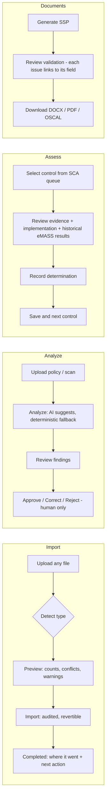
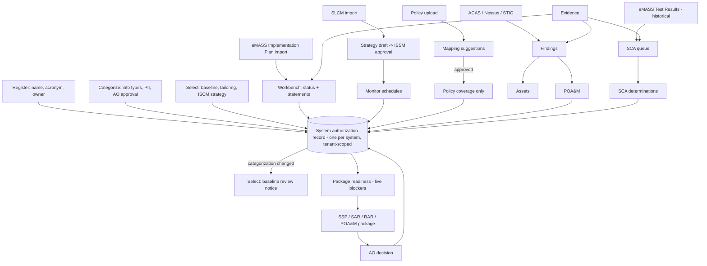

# 6 · Workflow diagrams

## Standard flows

## Connected system authorization record

The arrows that are missing or partial today are listed in `CONNECTEDNESS.md`. The backlog in `BACKLOG.md` closes them:
- TR → SCA queue
- ACAS → POA&M suggestion
- readiness meter
- import next action
