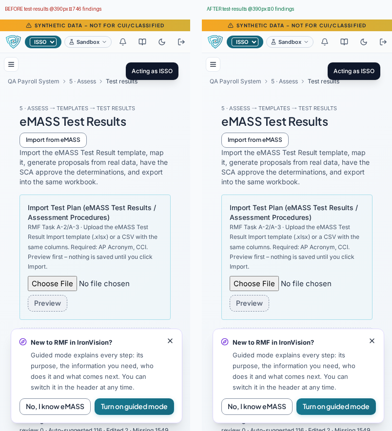
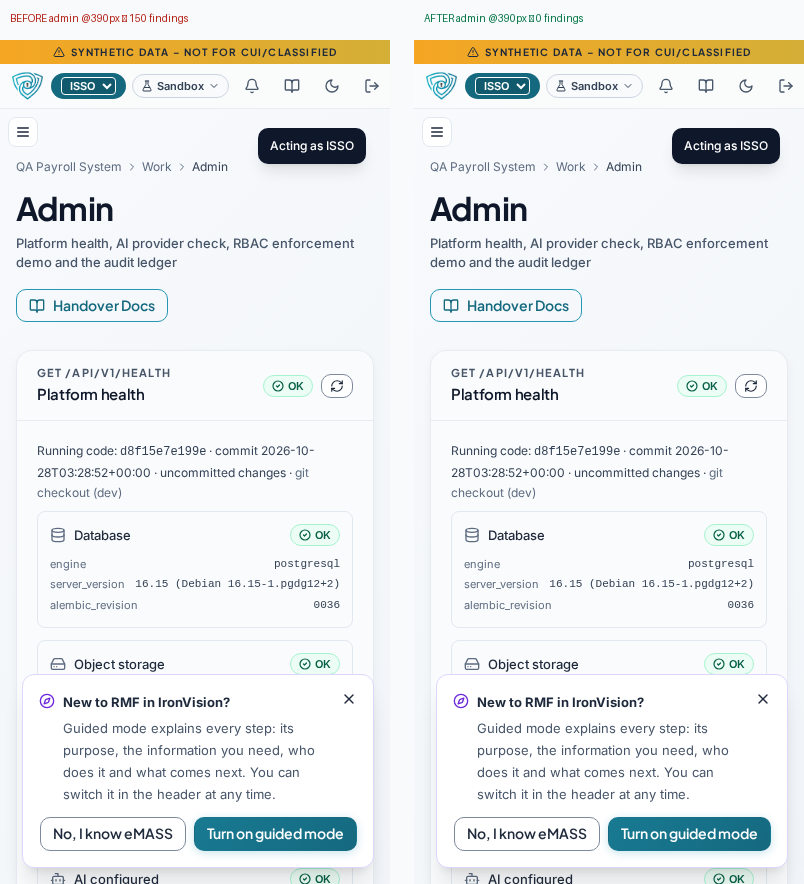
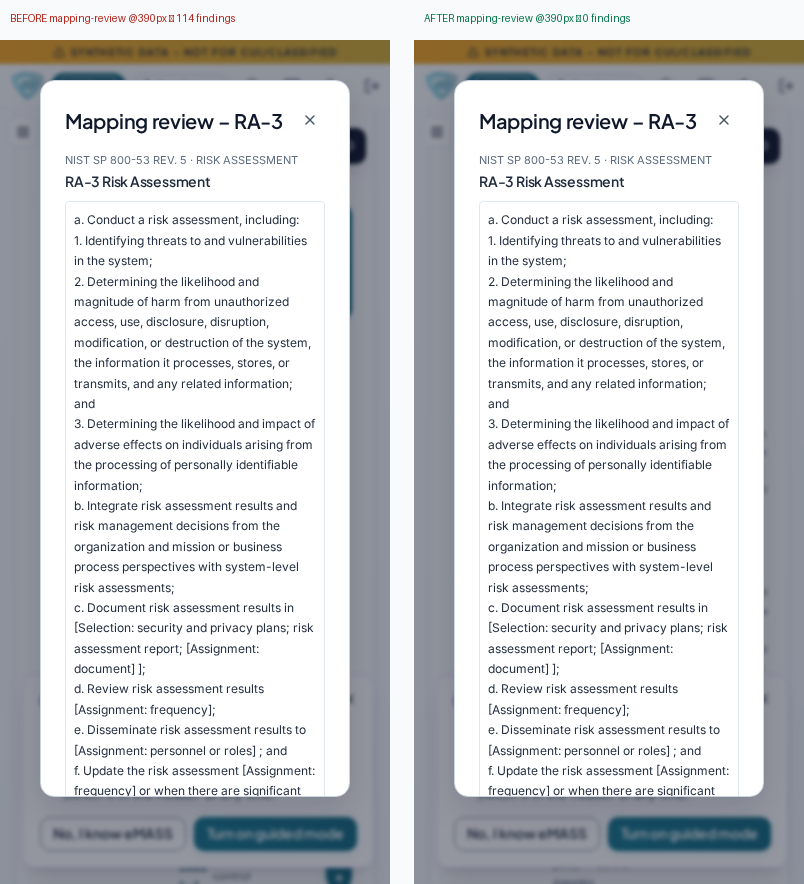
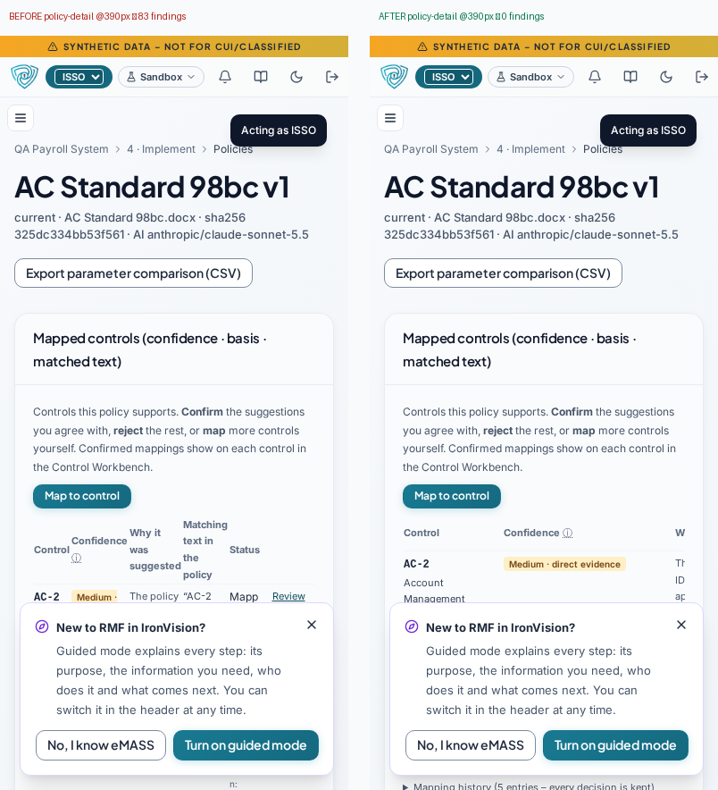
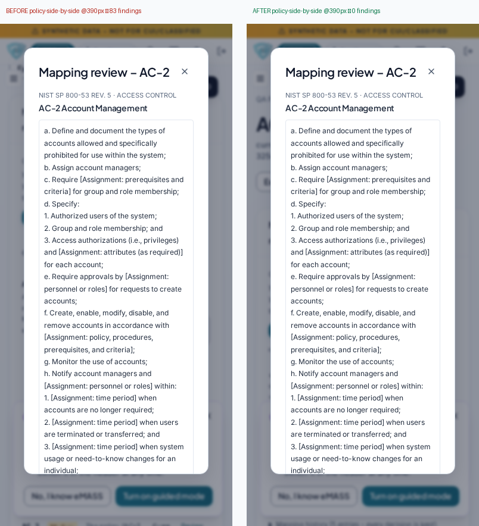
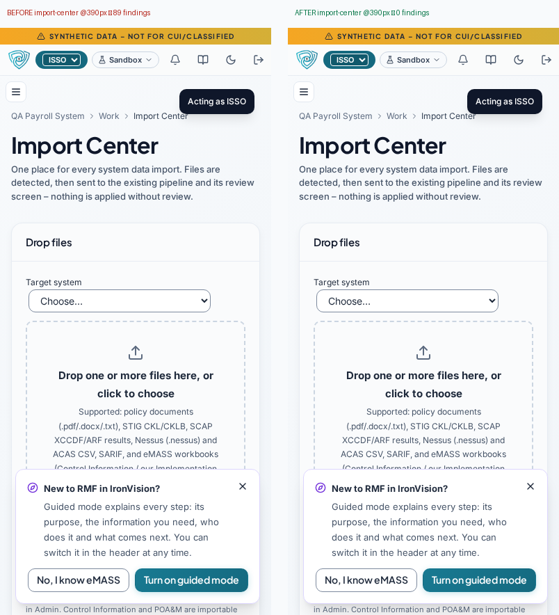

# Wrapped labels and squeezed text – before / after

Checked by `scripts/check_wrap.py` on every route of the layout checker at 1280, 768 and 390 wide, dark and light: **label-wrap** (button, button link, tab, chip/badge, status label or menu item on more than one line), **clipped** (visible button cut by a non-scrolling container, outside the viewport, or truncated label) and **squeezed** (text block or table cell under ~12 characters wide wrapping onto 3+ lines). `scripts/check_layout_overflow.py` still guards against horizontal page overflow.

## Root cause

- `overflow-wrap: anywhere` on `td`, `dd`, `code` and `.font-mono` (added by the earlier clipping fix) also shrinks the *min-content* width, so auto-layout tables and flex items squeezed columns to one word – or one character – per line instead of scrolling.
- Buttons, tabs and chips had no `white-space: nowrap` / `flex-shrink: 0`, so `min-w-0` flex rows compressed their labels into stacks.
- Toolbars were single non-wrapping rows.

## Fix (shared CSS / components)

`overflow-wrap: break-word` (breaks only words that cannot fit); nowrap + no-shrink for `.btn`, tabs, menu items, switches, chips, badges and status labels; table cells get minimum widths (9ch IDs/dates/statuses on one line, 14–24ch text) and every table scrolls horizontally inside `TableScroll` (or itself when unwrapped); `ActionBar` in `PageHeader`/`Panel` wraps whole buttons and on phones keeps the first action with the rest in a labelled **More ▾** menu (still in the DOM, one click away).

Note on the *before* numbers: the dark runs were taken live before the fix with the first version of the checker (it still counted buttons in horizontally-scrolling tables as `clipped` and multi-line tree rows as wrapped labels). The light runs were re-measured with the final checker on a build of the pre-fix commit `c107f4f` served against the same backend, so light before/after use identical rules.

## By check

| Check | dark-1280 | dark-768 | dark-390 | light-1280 | light-768 | light-390 |
|---|---|---|---|---|---|---|
| label-wrap | 23 → **0** | 141 → **0** | 440 → **0** | 144 → **0** | 222 → **0** | 378 → **0** |
| clipped | 2 → **0** | 39 → **0** | 333 → **0** | 0 → **0** | 0 → **0** | 0 → **0** |
| squeezed | 4 → **0** | 221 → **0** | 919 → **0** | 340 → **0** | 787 → **0** | 1135 → **0** |

## By route

| Route | dark-1280 | dark-768 | dark-390 | light-1280 | light-768 | light-390 |
|---|---|---|---|---|---|---|
| admin | 0 → **0** | 51 → **0** | 54 → **0** | 46 → **0** | 149 → **0** | 150 → **0** |
| assess | 0 → **0** | 0 → **0** | 0 → **0** | 1 → **0** | 1 → **0** | 0 → **0** |
| audit-log | 0 → **0** | 21 → **0** | 20 → **0** | 2 → **0** | 24 → **0** | 24 → **0** |
| authorization-package | 0 → **0** | 1 → **0** | 0 → **0** | 1 → **0** | 1 → **0** | 0 → **0** |
| authorize | 0 → **0** | 1 → **0** | 0 → **0** | 2 → **0** | 1 → **0** | 0 → **0** |
| catalog | 2 → **0** | 1 → **0** | 12 → **0** | 2 → **0** | 1 → **0** | 0 → **0** |
| catalog-tree | 2 → **0** | 1 → **0** | 19 → **0** | 2 → **0** | 1 → **0** | 0 → **0** |
| catalog-tree-system | 2 → **0** | 1 → **0** | 5 → **0** | 2 → **0** | 1 → **0** | 0 → **0** |
| categorize | 1 → **0** | 1 → **0** | 0 → **0** | 1 → **0** | 1 → **0** | 0 → **0** |
| categorize-fips | 0 → **0** | 0 → **0** | 0 → **0** | 1 → **0** | 1 → **0** | 0 → **0** |
| ccis | 0 → **0** | 1 → **0** | 61 → **0** | 1 → **0** | 1 → **0** | 85 → **0** |
| control-detail | 1 → **0** | 1 → **0** | 0 → **0** | 1 → **0** | 1 → **0** | 0 → **0** |
| control-detail-fips | 1 → **0** | 0 → **0** | 0 → **0** | 1 → **0** | 1 → **0** | 0 → **0** |
| dashboard | 0 → **0** | 1 → **0** | 0 → **0** | 6 → **0** | 1 → **0** | 0 → **0** |
| docs | 0 → **0** | 1 → **0** | 25 → **0** | 1 → **0** | 1 → **0** | 25 → **0** |
| emass | 0 → **0** | 7 → **0** | 0 → **0** | 1 → **0** | 7 → **0** | 0 → **0** |
| evidence-ledger | 0 → **0** | 60 → **0** | 63 → **0** | 24 → **0** | 24 → **0** | 27 → **0** |
| evidence-sources | 0 → **0** | 0 → **0** | 14 → **0** | 15 → **0** | 15 → **0** | 14 → **0** |
| help | 0 → **0** | 41 → **0** | 45 → **0** | 2 → **0** | 41 → **0** | 45 → **0** |
| implement | 1 → **0** | 1 → **0** | 0 → **0** | 1 → **0** | 1 → **0** | 0 → **0** |
| import-center | 0 → **0** | 45 → **0** | 89 → **0** | 5 → **0** | 45 → **0** | 89 → **0** |
| inheritance | 6 → **0** | 6 → **0** | 5 → **0** | 4 → **0** | 7 → **0** | 6 → **0** |
| inventory | 4 → **0** | 1 → **0** | 12 → **0** | 4 → **0** | 1 → **0** | 11 → **0** |
| mapping-review | 0 → **0** | 33 → **0** | 55 → **0** | 58 → **0** | 67 → **0** | 114 → **0** |
| monitor | 0 → **0** | 1 → **0** | 0 → **0** | 1 → **0** | 1 → **0** | 0 → **0** |
| my-work | 0 → **0** | 1 → **0** | 0 → **0** | 1 → **0** | 1 → **0** | 0 → **0** |
| notifications | 0 → **0** | 1 → **0** | 0 → **0** | 1 → **0** | 1 → **0** | 0 → **0** |
| parameter-comparison | 1 → **0** | 1 → **0** | 0 → **0** | 1 → **0** | 1 → **0** | 0 → **0** |
| poam | 0 → **0** | 2 → **0** | 3 → **0** | 1 → **0** | 1 → **0** | 0 → **0** |
| policy-auditor | 0 → **0** | 1 → **0** | 1 → **0** | 1 → **0** | 1 → **0** | 0 → **0** |
| policy-detail | 0 → **0** | 52 → **0** | 122 → **0** | 12 → **0** | 54 → **0** | 83 → **0** |
| policy-side-by-side | 0 → **0** | 52 → **0** | 122 → **0** | 12 → **0** | 54 → **0** | 83 → **0** |
| portfolio | 1 → **0** | 1 → **0** | 0 → **0** | 1 → **0** | 1 → **0** | 0 → **0** |
| prepare | 1 → **0** | 1 → **0** | 0 → **0** | 1 → **0** | 1 → **0** | 0 → **0** |
| reviews | 0 → **0** | 1 → **0** | 4 → **0** | 1 → **0** | 1 → **0** | 3 → **0** |
| rmf-workflow | 1 → **0** | 1 → **0** | 0 → **0** | 1 → **0** | 1 → **0** | 0 → **0** |
| sca-workspace | 0 → **0** | 1 → **0** | 23 → **0** | 6 → **0** | 1 → **0** | 3 → **0** |
| select | 1 → **0** | 1 → **0** | 1 → **0** | 1 → **0** | 1 → **0** | 0 → **0** |
| select-fips | 1 → **0** | 1 → **0** | 0 → **0** | 1 → **0** | 1 → **0** | 0 → **0** |
| system-detail | 1 → **0** | 1 → **0** | 1 → **0** | 1 → **0** | 1 → **0** | 1 → **0** |
| systems | 1 → **0** | 1 → **0** | 2 → **0** | 1 → **0** | 1 → **0** | 2 → **0** |
| test-results | 0 → **0** | 1 → **0** | 934 → **0** | 254 → **0** | 488 → **0** | 746 → **0** |
| traceability | 0 → **0** | 3 → **0** | 0 → **0** | 1 → **0** | 3 → **0** | 2 → **0** |
| workbench | 1 → **0** | 1 → **0** | 0 → **0** | 1 → **0** | 1 → **0** | 0 → **0** |
| **Total** | 29 → **0** | 401 → **0** | 1692 → **0** | 484 → **0** | 1009 → **0** | 1513 → **0** |

## Worst 6 screens (light, narrow) – before / after

